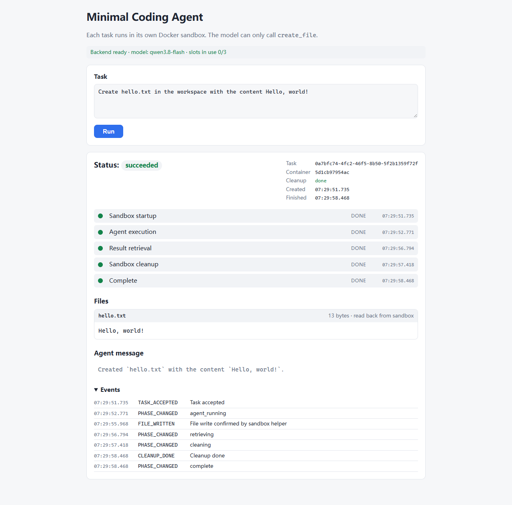

# Minimal Coding Agent

A local web app where a user types a natural-language request, clicks **Run**, and a coding agent backed by a **real LLM** creates the file inside a **fresh, isolated Docker sandbox** made just for that task. The page shows live progress through each phase. When the task ends, it shows the file name and the content **read back from the sandbox**, then the final status and the cleanup result.

```
Create hello.txt in the workspace with the content Hello, world!
```



## Demo and verification evidence

All evidence below comes from real runs against `qwen3.8-flash` (Alibaba Cloud Model Studio / DashScope) and a real Docker engine.

| What | Where |
| --- | --- |
| Screen recordings (automated Playwright run of the real page in headless Chrome, all scenarios below) | [main tab](docs/evidence/video/real-model-demo-main-tab.webm), [second tab of the concurrency test](docs/evidence/video/real-model-demo-concurrent-tab2.webm) (WebM; download or open the raw file if GitHub does not preview it) |
| Full-page screenshots | [original task](docs/evidence/s1a-original.png), [exact content](docs/evidence/s1b-exact.png), [random name 1](docs/evidence/s2-random-1.png), [random name 2](docs/evidence/s2-random-2.png), [nested dirs + Chinese + multi-line](docs/evidence/s3-nested-multi.png), [quotes/backslashes/HTML](docs/evidence/s4-special-chars.png), [concurrent A](docs/evidence/s5-concurrent-1.png), [concurrent B](docs/evidence/s5-concurrent-2.png) |
| Per-check results (expected vs. read-back content, UTF-8 byte counts, task/container IDs, cleanup, leftover check) | [docs/evidence/real-browser-results.json](docs/evidence/real-browser-results.json) |
| Container lifecycle (create → start → die → destroy for every container) | [docs/evidence/container-lifecycle.md](docs/evidence/container-lifecycle.md), raw [docker-events.log](docs/evidence/docker-events.log) |
| Full verification record: inputs, expectations, results, bugs found and fixed, limitations (in Chinese) | [docs/verification.md](docs/verification.md) |

The recordings were made by a test script driving the real page. They are not hand-made screen captures. No public deployment exists: the app is meant to be run locally (see below).

## How it works

```
Browser ──POST /tasks──▶ FastAPI ──▶ TaskManager (admission, 60 s deadline, cleanup)
   ▲  poll GET /tasks/{id}            │
   │                                  ├─▶ SandboxManager: docker create/start (one container per task)
   │                                  ├─▶ Agent loop ◀──▶ LLM (Chat Completions, tool_choice=auto)
   │                                  │       model calls create_file(path, content)
   │                                  │       └─▶ docker exec -i … python3 -I -B /opt/app/tool.py write  (JSON on stdin)
   │                                  ├─▶ read back every written path: tool.py read (from the container)
   └──── snapshot with read-back files ◀── docker rm --force + confirm the container is gone
```

- **The model decides.** The model sees one tool, `create_file(path: string, content: string)`. File names and contents come only from its tool arguments; nothing is hard-coded or parsed out of the request.
- **One sandbox per task.** Each accepted task gets its own new container, which is removed and confirmed gone once the task finishes, whether it succeeds, fails or times out.
- **Results come from read-back.** After the agent finishes, the backend reads every written path back out of the container and returns those bytes. It never echoes the tool arguments. A test changes the file inside the container between the write and the read-back to prove this.
- **Path policy is enforced twice.** Absolute paths, `..`, backslashes, drive letters, empty/`.` components, control characters and over-long names are rejected by both the backend and the in-container helper. The helper walks directories with `dir_fd` + `O_NOFOLLOW`, rejects symlinks, hard links, FIFOs and directory targets, and writes through a temp file + atomic `os.replace`.
- **Failures are explicit.** The task snapshot carries `status` / `execution_status` / `failed_phase` / `error{code,message}` / `cleanup{status,error}` / `warnings` / `events`, and the UI shows all of them. Examples: `PATH_REJECTED`, `NO_FILES_CREATED`, `TASK_TIMEOUT`, `LLM_AUTH_FAILED`, `CLEANUP_FAILED`.

| Path | Responsibility |
| --- | --- |
| `app/main.py`, `app/__main__.py` | FastAPI app factory, lifecycle (startup checks, shutdown cleanup), JSON API, static page, Host/Origin/CSP checks; loopback-only single-worker launcher |
| `app/task_manager.py` | Atomic admission (max 3, else 429), absolute deadline, state snapshots, independent cleanup budget, degraded mode and background recovery |
| `app/agent.py` | The one agent loop, shared by the real model and test fakes; tool-call validation and budgets |
| `app/llm.py` | `LLMClient` interface; async httpx Chat Completions adapter (no retries, no redirects, 1 MiB response cap, error mapping) |
| `app/sandbox.py`, `app/process.py` | Docker CLI via argv only (never a shell); bounded pipes; create/start/exec/rm/confirm; leftover sweeping |
| `shared/path_policy.py` | Pure string path/size validation shared by backend and helper |
| `sandbox/Dockerfile`, `sandbox/tool.py` | Pinned base image; root-owned read-only helper in `/opt/app` |
| `static/` | Page: input, Run, phase progress, events, files, errors, cleanup status. All text goes through `textContent` |
| `tests/` | Unit tests, real-Docker integration tests, HTTP end-to-end tests |
| `scripts/` | `real_browser_e2e.py` (real-model browser check), `fake_ui_server.py` (UI failure displays with a scripted model), `demo_step2.py` |

## Requirements

- Python 3.12 and [uv](https://docs.astral.sh/uv/)
- Docker with a **Linux** engine (Windows containers are not supported)
- An API key for an OpenAI-compatible Chat Completions endpoint that supports tool calling

**Verified platform:** Windows 11 with native CPython 3.12.13, Docker Desktop 4.37.1 / Engine 27.4.0 (Linux containers, cgroup v1). WSL2 and native Linux backends were not run. The code only uses argv-based Docker CLI calls and asyncio subprocesses, so they are expected to work.

## Setup

```bash
uv python install 3.12
uv sync --locked --python 3.12

# Build the sandbox image ahead of time (tasks never pull or build images)
docker pull python:3.12.12-slim-bookworm@sha256:593bd06efe90efa80dc4eee3948be7c0fde4134606dd40d8dd8dbcade98e669c
docker build -f sandbox/Dockerfile -t minimal-coding-agent-sandbox:step2 .
```

Pinned versions (as installed and tested): FastAPI 0.128.8 (Starlette 0.52.1), Uvicorn 0.39.0, httpx 0.28.1; pytest 8.3.5, pytest-asyncio 0.25.3. `uv.lock` is the actual resolved lock file. `.dockerignore` is an allow-list, so the image contains only the helper and the shared validation module.

## Configuration

Copy `.env.example` to `.env` (git-ignored) or set the variables in the environment. Real environment variables take precedence over `.env`.

| Variable | Meaning |
| --- | --- |
| `LLM_API_KEY` | Provider API key. Used only by the backend process: never passed into containers, never logged, never returned by `/health`. |
| `LLM_BASE_URL` | Provider base URL ending in `/v1` (or the provider's equivalent). HTTPS required; plain HTTP is accepted only for loopback. |
| `LLM_MODEL` | Model ID, exactly as the provider documents it |
| `LLM_TOKEN_PARAM` | `max_tokens` (default) or `max_completion_tokens` (required by some newer OpenAI models) |
| `LLM_MAX_OUTPUT_TOKENS` | Default `4096` |
| `LLM_PARALLEL_TOOL_CALLS` | `false` (default; sends `parallel_tool_calls=false`) or `omit` if the provider rejects that field. Tool calls are executed sequentially either way. |
| `MCA_HOST` / `MCA_PORT` | Default `127.0.0.1` / `8000`; only loopback hosts are allowed |
| `MCA_PROJECT_ID` / `MCA_IMAGE` | Container label namespace / sandbox image tag |

**Verified provider and model:** Alibaba Cloud Model Studio (DashScope) OpenAI-compatible mode, `LLM_BASE_URL=https://dashscope.aliyuncs.com/compatible-mode/v1`, `LLM_MODEL=qwen3.8-flash`, with the defaults above. No other provider or model was tested.

Execution limits (timeouts, concurrency, sizes) are server settings. Neither the client nor the model can change them. The production entry point refuses to start without LLM configuration.

## Run

```bash
python -m app        # i.e. .venv/Scripts/python.exe -m app on Windows, .venv/bin/python -m app on Linux
```

This is equivalent to `uvicorn app.main:create_app --factory --host 127.0.0.1 --port 8000 --workers 1`. Open <http://127.0.0.1:8000> on the same machine; it is a local app, not a hosted demo.

On startup the backend checks, in order: the Linux Docker daemon, the local image, a sweep of leftover containers from this project, and a smoke sandbox (uid 1000, effective memory/swap limits, nested write, independent read-back, removal confirmed). Until all of these pass, `/health` reports not ready, `POST /tasks` returns 503 and the page says why. While Docker is still starting, the checks are retried every 5 s.

## API

| Method | Behavior |
| --- | --- |
| `POST /tasks` with `{"request": "..."}` | `202 {task_id, status_url}`. Errors: `422` invalid input, `413` body > 64 KiB (counted while streaming), `415` not JSON, `403` foreign `Origin`, `429` all 3 slots busy, `503` not ready / cleanup degraded |
| `GET /tasks/{id}` | Task snapshot (status, phase, execution_status, failed_phase, cleanup, files, error, warnings, events, timestamps, revision). `404` if unknown, expired or lost on restart |
| `GET /health` | Readiness, startup-check result, slot usage, model name; never includes secrets |

## Tests

```bash
# 1) Unit tests: no Docker, no API key (path policy, subprocess limits, LLM adapter against a mock provider, HTTP contract)
python -m pytest -q -p no:cacheprovider

# 2) Plus real-Docker integration and HTTP end-to-end tests (image must be built; still no key — an injected FakeLLM drives the same Agent/TaskManager/SandboxManager code)
python -m pytest --docker -q -p no:cacheprovider

# 3) UI failure displays with a scripted model (page is labelled "FakeLLM"): http://127.0.0.1:8001
python -m scripts.fake_ui_server

# 4) Real-model browser end-to-end check (app must be running with a real key; costs model tokens).
#    Playwright is a test-only tool kept out of the project dependencies; uses the installed Google Chrome.
uv venv pwvenv && uv pip install --python pwvenv/Scripts/python.exe playwright==1.49.1
pwvenv/Scripts/python.exe -m playwright install ffmpeg      # only needed for video recording
pwvenv/Scripts/python.exe scripts/real_browser_e2e.py
```

### Recorded results (2026-10-18; details in [docs/verification.md](docs/verification.md))

**Deterministic suite (FakeLLM + real Docker):** `pytest --docker` gave **133 passed** (97 unit + 36 real-Docker), with no skips and no failures. Afterwards no project containers were left in any state.

| Requirement | Tests |
| --- | --- |
| Successful creation and read-back | `test_api_docker.py::test_http_success_flow`, `test_docker.py::test_success_multiple_overwrite_empty_and_nested` (overwrite returns the last version) |
| Content comes from read-back | `test_docker.py::test_readback_is_actual_container_content` (file is changed inside the container after the write; the API returns the changed bytes) |
| Path traversal rejected by the backend | `test_policy.py::test_rejected_paths`; `test_docker.py::test_path_rejection_uncorrected` (before cleanup, checks that `/secret.txt` does not exist and the `/workspace/outside.txt` sentinel is unchanged); `test_direct_helper_path_policy_and_no_partial_overwrite` (calls the helper directly, bypassing the backend); `test_helper_rejects_unsafe_filesystem` (symlinks, middle-directory links, hard links, FIFOs, directories) |
| Execution timeout | `test_slow_llm_timeout_no_late_write`, `test_written_but_not_read_before_timeout`, `test_readback_timeout_is_not_success`, `test_slow_container_exec_killed_by_cleanup`, `test_api_docker.py::test_http_timeout_reported`. Each asserts final `timeout`, no late success, and that the container is gone |
| No tool call / invalid arguments / unknown tool / capacity | `test_model_failure_branches` (exact rejection codes reach the model and the UI), `test_concurrent_isolation_and_fourth_rejected`, `test_http_fourth_concurrent_task_gets_429` |

**Real model in a real browser (`qwen3.8-flash`):** `scripts/real_browser_e2e.py` passed **8/8** in each of two runs after the fixes below. Expected names and contents are generated *before* submission. A check passes only if all of the following hold: the read-back content equals the expected string exactly, `size_bytes` equals its UTF-8 length, the rendered DOM text matches and contains no elements, the status is `succeeded`, cleanup is `done`, and `docker ps -a --filter label=agent-task=<id>` is empty in every container state.

| Scenario | Result (final run) |
| --- | --- |
| Original task, wording unchanged | `hello.txt` = `Hello, world!`, 13/13 bytes |
| Explicit "exactly 13 characters, no newline" | `Hello, world!`, 13/13 bytes |
| Random file name + random marker (×2) | exact match, 21/21 bytes each |
| Two directories, Chinese, multi-line, one request | both files exact: 77/77 and 40/40 bytes |
| Quotes, backslashes, newlines, `<b>`, ``, `<script>` | stored verbatim (147/147 bytes); displayed as text, nothing executed |
| Two concurrent tasks writing the same `shared.txt` | different containers, overlapping execution, each read back its own marker |

**Bug found by these runs:** before the fix, the model wrote `"Hello, world!\n"` (14 bytes) for the original wording. The read-back reported that faithfully, so the result was correctly *not* counted as an exact match. The fix is a system-prompt instruction to pass user-specified content character for character. The backend never strips or rewrites model content. A real-model request to write `../secret.txt` was refused by the model itself without calling the tool, so backend rejection is proven by the deterministic tests above, not by that run.

## Resource limits

| Item | Limit |
| --- | --- |
| Task deadline | 60 s from admission (covers sandbox start, LLM, tools, read-back); each LLM call ≤ 25 s; each Docker operation ≤ 10 s |
| Cleanup | separate 15 s budget |
| Concurrency | 3 executing/cleaning tasks; no queue; the 4th gets `429` |
| Agent | ≤ 8 LLM requests, ≤ 16 tool calls, ≤ 8 distinct files |
| Input sizes | request ≤ 8 KiB UTF-8; HTTP body ≤ 64 KiB; each file write/read ≤ 64 KiB; path and each path component ≤ 255 bytes |
| LLM response | ≤ 1 MiB; no retries; redirects not followed |
| Container | `--network none`, `--read-only`, `/workspace` tmpfs 10 MiB (`noexec,nosuid,nodev`, mode 0700, uid 1000), `--user 1000:1000`, `--cap-drop ALL`, `no-new-privileges`, `--pids-limit 64`, `--memory 128m --memory-swap 128m`, `--cpus 0.5`, `--restart no`, `--rm`, PID 1 is a bounded `sleep` (85 s). No bind mounts, no Docker socket, no published ports, no host environment variables |
| Records | finished tasks kept 30 min, at most 100 records; ≤ 128 events per task |

## Isolation risks not addressed

- **Shared kernel.** Containers share the kernel of the Linux host or Docker Desktop VM; there is no VM-level isolation. Higher-risk workloads should evaluate gVisor or Firecracker.
- **Docker daemon privilege.** Whoever controls a rootful daemon effectively controls the environment it runs in (the Linux VM under Docker Desktop). Running the backend in a container with the socket mounted would not create a security boundary.
- **UID mapping.** userns-remap is not enabled; under a typical rootful Linux daemon, container uid 1000 is host uid 1000. Rootless Docker and Docker Desktop differ.
- **seccomp/AppArmor.** No custom profiles. On the verification machine, `docker info` reported `seccomp,profile=unconfined` and no AppArmor, so no seccomp filtering or AppArmor protection is claimed for that environment.
- **Writable surface.** `--read-only` covers the image root filesystem, but Docker-managed `/proc`, `/dev` etc. still exist; the tool protocol is what restricts file creation to `/workspace`. `noexec` does not stop an interpreter from reading a script; the real boundary is that only the fixed file tool is exposed and model-generated code is never executed.
- **Data leaving the machine.** The user request, the model's tool arguments and tool results go to the configured LLM provider (the final read-back is not sent back to the model). Retention depends on the provider. A cancelled call may keep running and be billed on the provider's side.
- **No authentication.** Local single-user demo only: no accounts, per-user quotas, distributed rate limiting or audit. The app binds to 127.0.0.1, validates `Host` and `Origin`, and enables no CORS. It is not suitable for public deployment as is.
- **Single instance, in-memory state.** Task state is lost on restart. Only one backend per `MCA_PROJECT_ID` (the startup sweep removes all containers with that label); there is no distributed lease.
- **Recovery windows.** The startup sweep, a 5 s background reaper, the bounded `sleep` and `--rm` all reduce leftovers. A daemon outage, a created-but-never-started container or a late `create` can still leave a window. If cleanup cannot be confirmed, the service goes `degraded` and refuses new tasks until recovery succeeds.
